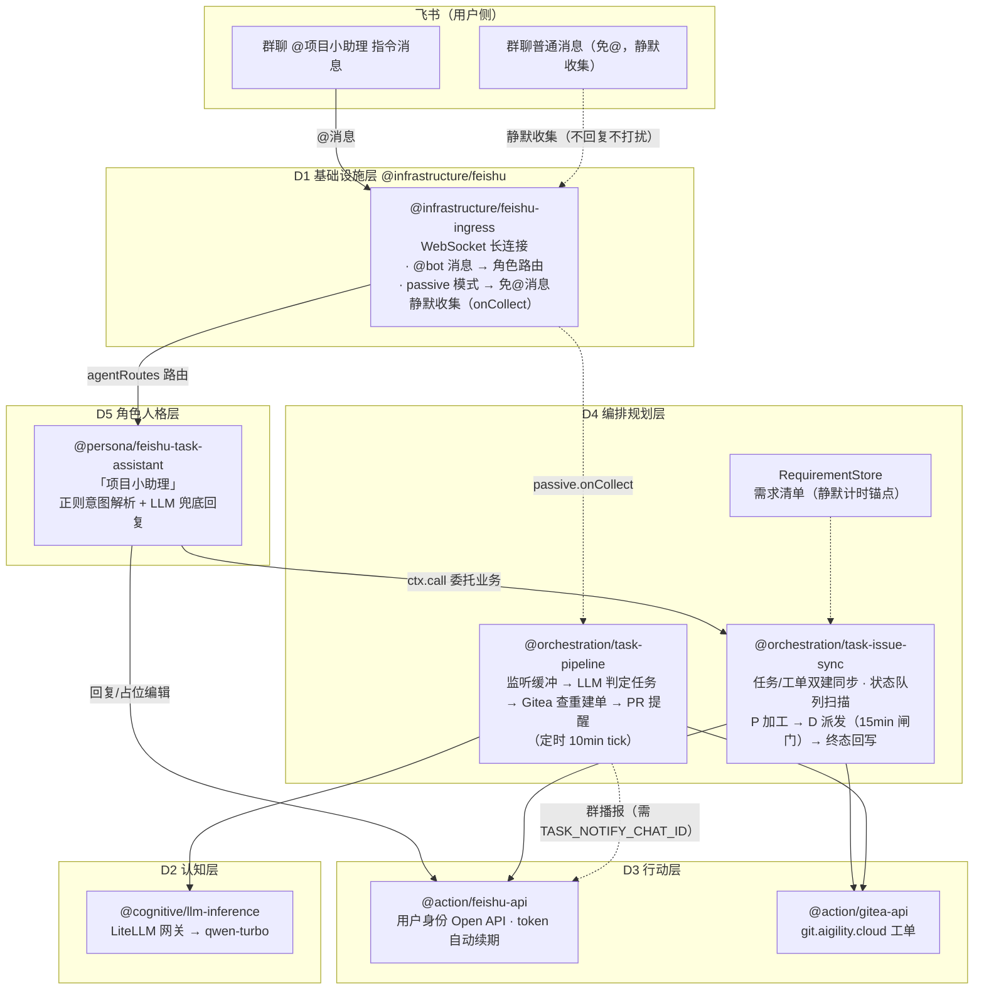

# 项目小助理（feishu-task-loop）架构评审与运行指南

> 评审时间：2026-09-28 · 状态：✅ 机器人已跑通，静默记录链路已修复可用

## 一、架构图



分层对应关系（DDD 五域）：

| 层 | 模块 | 职责 |
|---|---|---|
| D1 基础设施 | `@infrastructure/feishu` | WebSocket 长连接收消息、@剥离、passive 静默收集 |
| D2 认知 | `@cognitive/llm-inference` | LLM 判定/兜底回复 |
| D3 行动 | `@action/feishu-api` `@action/gitea-api` | 真正执行：飞书任务 API、Gitea 工单 API |
| D4 编排 | `task-pipeline` `task-issue-sync` | 静默记录汇总、查重建单、状态队列派发 |
| D5 人格 | `feishu-task-assistant` | 「项目小助理」形象、意图解析，只管理不执行 |

## 二、「静默记录任务」链路（本次修复的功能）

```
群聊免@消息 → feishu-ingress passive（按 TASK_LISTEN_CHAT_IDS 白名单过滤）
           → collectMessage() 推入监听缓冲（内存，上限 200 条）
           → task-pipeline 每 10min tick：LLM 判定哪些是任务
           → Jaccard 相似度与 Gitea open 工单 + 飞书任务查重
           → 新任务建 Gitea 工单（[P0-P3] 前缀）→ 双建同步飞书任务 → 群播报
```

## 三、发现的问题与修复

### 已修复（第二轮：静默记录"从来没听到过"的根因）⚠️ 关键

0. **SDK 通道层 PolicyGate 把免@群消息整条丢弃（架构缺陷，实锤）**
   `@larksuiteoapi/node-sdk` 的 `LarkChannel` 内置 `PolicyGate`，
   `requireMention` **默认 true**——未 @bot 的群消息在进入 feishu-ingress 的
   message 处理器之前就被以 `no_mention` 拒绝。而 feishu-ingress 从未配置
   `policy`，所以 `passive.onCollect` **一次都不会被调用**：静默记录任务链路
   从上线起就从未收到过任何消息（历史日志中 0 条 `passive collect` 可证）。
   修复：`passive.enabled` 时注入 `policy: { requireMention: false }`，
   @bot 指令路由仍由本层 shouldProcessMessage 判定，@所有人仍默认拦截。

**项目小助理获取任务的 4 种方式与状态：**

| 途径 | 链路 | 状态 |
|---|---|---|
| ① @bot 指令 | 群/私聊 @项目小助理「建任务：xxx」→ 意图解析 → 双建 | ✅ 一直正常（日志可见） |
| ② 免@静默收集 → 流水线汇总 | passive → collectMessage → quiet window → LLM 判定 → 建单 | 🔴→✅ 通道层拦截已修复，待实测验证 |
| ③ 状态队列扫描 | task-issue-sync 定时扫飞书任务清单（P 加工/D 派发/终态回写） | ✅ 正常（token 路径修复后） |
| ④ 双建同步回灌 | Gitea 建单 → sync-issue → 飞书任务 | ✅ 正常 |

### 已修复（第一轮）

1. **`FEISHU_USER_TOKEN_STORE` 缺省相对路径 bug（架构缺陷）** ✅ 已根治
   `@action/feishu-api` 默认 token 落盘路径是 `feishu/user_token.local.json`（相对 cwd），
   而 `pnpm --filter feishu-task-loop start` 的 cwd 在子包目录 → 每次状态队列扫描报
   `ENOENT ... user_token.local.json`，dispatch-scan（P 加工/D 派发/终态回写）全部失效。
   修复：新增 `resolveTokenStorePath()`（feishu-api.ts 导出），相对路径一律相对仓库根
   解析，绝对路径原样返回；`.env` 同时写入绝对路径双保险。含单测。

### 已修复（计划 2.1 → 2.3 → 2.2 → 4.1）

- **2.1 缺省 token 路径下沉** ✅：见上条；`feishu-api.test.ts` 15/15 通过。
- **2.3 passive 防回声** ✅：`feishu-ingress.ts` 新增纯函数 `shouldPassiveCollect()`
  （群聊 + 未@ + 有文本 + chatIds 白名单 + `excludeSenderIds` 排除机器人自身/其他
  机器人）；示例应用接入 env `TASK_EXCLUDE_SENDER_IDS`。6 个新单测，18/18 通过。
- **2.2 静默窗口防抖** ✅：`task-pipeline.ts` 新增 `shouldFireTick()` 调度判定——
  缓冲有消息且距最后一条免@消息静默满 `quietMs`（env `TIMEM_QUIET_SUMMARIZE_MS`，
  默认 10min）即汇总；缓冲空则按 `intervalMs` 兜底跑（保 PR 轮询）。讨论进行中
  不再被拦腰汇总，停嘴后也不用干等固定 tick。5 个新单测，12/12 通过。
- **4.1 pnpm "损坏"** ✅ 证伪：是执行沙箱只允许写 workspace，pnpm 写 `~/.local/state`
  被拒才报 SQLite 错。用户本机 pnpm 正常（v11.28.0），无需修复。

### 遗留的架构弱点（非阻塞，按优先级）

3. **静默缓冲是模块级内存变量**：进程重启丢失最多一个 tick（10min）的免@消息，
   `ctx.getState` 里的已见 PR/任务状态同理。文档已自认"可接受"，但若要可靠，
   缓冲应落盘（哪怕 append-only JSONL）。
4. ~~**固定间隔 ≠ 真静默窗口**~~ ✅ 已按 2.2 修复：quiet window 防抖已实现。
5. **`TASK_NOTIFY_CHAT_ID` 未配置**：播报与 PR 提醒关闭，静默记录建了单用户也
   看不到反馈。在群设置里把目标群的 chatId 写入 `.env` 即可闭环。
6. **passive 收集防回声已实现但需配置**：设置 `TASK_EXCLUDE_SENDER_IDS=ou_xxx,ou_yyy`
   （机器人自身与其他机器人的 open_id）即可启用；未配置时多机器人同群仍有回声风险。

## 四、运行方式

```bash
# pnpm 修好前的启动方式（项目根目录执行）
rm -f /tmp/aigility-feishu-task-loop.lock   # 僵锁自愈
cd examples/feishu-task-loop && ./node_modules/.bin/tsx src/index.ts

# 验证点（启动日志应出现，且无 ENOENT）：
# ✅ 飞书机器人已连接 (appId=cli_a9e24e913a39dcd6)
# 状态队列: P 加工 → D 派发 → 终态回写
```

交互验证：飞书群里 `@项目小助理 建任务：xxx` / `查列表`；
静默记录：在群里发一条不带 @ 的任务描述，等下一 tick（或缩短
`TASK_PIPELINE_INTERVAL_MS` 验证）。
